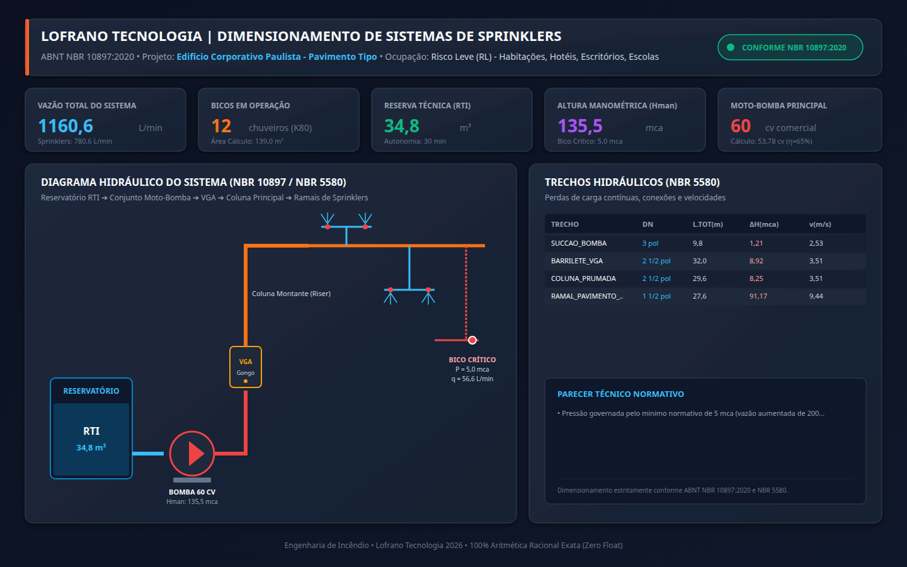
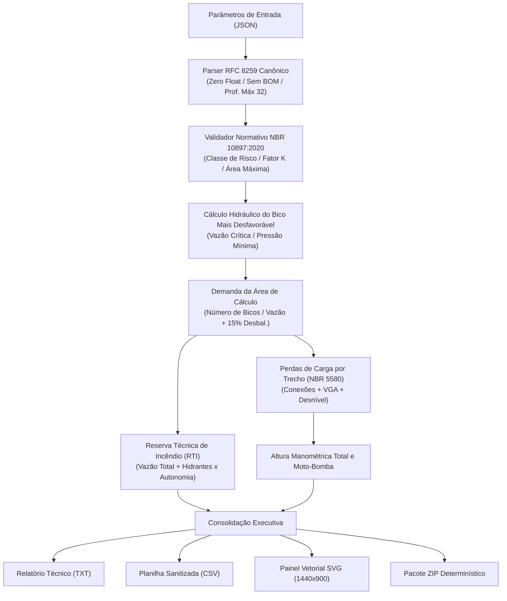

# Dimensionamento de Chuveiros Automáticos (Sprinklers) - ABNT NBR 10897:2020

[](https://github.com/martinlofranodeoliveira/dimensionamento-sistemas-sprinklers-nbr10897/actions/workflows/ci.yml)
[](https://www.python.org/)
[](https://opensource.org/licenses/MIT)
[](https://www.abnt.org.br/)
[-emerald.svg)](https://docs.python.org/3/library/fractions.html)

Motor computacional em Python puro para cálculo, verificação e dimensionamento hidráulico de sistemas de proteção contra incêndio por **chuveiros automáticos (sprinklers)** conforme a norma brasileira **ABNT NBR 10897:2020** e normas complementares de tubulações de condução de aço carbono **ABNT NBR 5580**.

Desenvolvido segundo as diretrizes de integridade matemática da **Lofrano Tecnologia**, o projeto opera com **aritmética estritamente racional exata (`fractions.Fraction` e inteiros)**, eliminando quaisquer erros de arredondamento inerentes ao padrão IEEE-754 (`float`).

---

## Painel Executivo do Sistema



---

## Recursos e Destaques

- **100% Conforme ABNT NBR 10897:2020**: Tabelas de classificação de riscos de ocupação (Risco Leve, Risco Ordinário Grupos 1 e 2, Risco Extra Grupos 1 e 2).
- **Aritmética Racional Exata**: Pressões, vazões, áreas de operação, volumes de reserva técnica de incêndio (RTI) e perdas de carga calculadas sem nenhum ponto flutuante binário.
- **Hidráulica do Bico Crítico e Fator K**: Dimensionamento automático pelo coeficiente de descarga nominal ($K80$, $K115$, $K160$, $K200$) com verificação de pressão mínima residual normatizada ($0{,}5\text{ bar} = 5\text{ mca}$ para RL/RO e $0{,}7\text{ bar} = 7\text{ mca}$ para RE).
- **Desbalanceamento Hidráulico Normativo**: Aplicação de fator de sobrepressão de cálculo (+15% padrão) sobre a vazão nominal da área de operação.
- **Reserva Técnica de Incêndio (RTI)**: Dimensionamento exato da autonomia do reservatório considerando a soma da demanda de sprinklers com os hidrantes adicionais requeridos para cada classe de ocupação.
- **Perda de Carga em Tubulações NBR 5580**: Hazen-Williams com comprimentos equivalentes para joelhos, tês, válvulas de gaveta, válvulas de retenção e Válvula de Governo e Alarme (VGA).
- **Potência do Conjunto Moto-Bomba**: Cálculo da altura manométrica total e seleção imediata do motor elétrico padronizado comercial ($cv$).
- **Exportação Multiformato e ZIP Seguro**: Relatórios executivos formatados em texto puro, planilhas CSV com sanitização contra injeção de fórmulas e pacotes ZIP determinísticos com carimbo fixo (`2026-01-01 00:00:00`) gerados sob flags `os.O_EXCL`.

---

## Arquitetura do Sistema



---

## Formulações Matemáticas Normativas

### 1. Vazão Mínima pelo Bico Crítico e Fator K

A vazão teórica requerida por cada chuveiro automático na área mais desfavorável é dada pela densidade mínima normatizada multiplicada pela área de cobertura real do bico:

$$q_{\text{densidade}} = d \times A_{\text{bico}} \quad [\text{L/min}]$$

A pressão residual requerida no bico crítico pelo Fator K nominal é expressa por:

$$P_{\text{requerida}} = 10 \times \left(\frac{q_{\text{densidade}}}{K}\right)^2 \quad [\text{mca}]$$

Caso a pressão calculada seja inferior ao mínimo estabelecido pela NBR 10897:2020 ($P_{\min} \ge 5\text{ mca}$ para Risco Leve/Ordinário e $7\text{ mca}$ para Risco Extra), a pressão adotada é fixada no patamar mínimo e a vazão é ajustada para:

$$q_{\text{adotada}} = K \times \sqrt{\frac{P_{\min}}{10}} \quad [\text{L/min}]$$

### 2. Quantidade de Bicos e Vazão do Sistema

O número de chuveiros automáticos operando simultaneamente na área de operação é calculado por:

$$N_{\text{bicos}} = \max\left(1, \; \left\lceil \frac{A_{\text{operacao}}}{A_{\text{bico}}} \right\rceil\right)$$

A vazão total dos bicos acrescida da sobrepressão por desbalanceamento hidráulico (+15% padrão):

$$Q_{\text{sprinklers}} = \left(N_{\text{bicos}} \times q_{\text{adotada}}\right) \times \left(1 + \frac{\text{margem}}{100}\right)$$

### 3. Reserva Técnica de Incêndio (RTI)

A reserva técnica armazena o volume de água suficiente para a vazão combinada de chuveiros e hidrantes durante a autonomia exigida:

$$V_{\text{rti}} = \frac{(Q_{\text{sprinklers}} + Q_{\text{hidrantes}}) \times T_{\text{autonomia}}}{1000} \quad [\text{m}^3]$$

---

## Classes de Risco (Tabela 1 - NBR 10897:2020)

| Código | Ocupação Típica | Densidade (mm/min) | Área Mínima Op. ($m^2$) | Área Máx/Bico ($m^2$) | RTI (min) | Hidrantes (L/min) |
| :--- | :--- | :---: | :---: | :---: | :---: | :---: |
| `risco_leve` | Habitações, Hotéis, Escritórios, Escolas | 4,1 | 139 | 18,6 | 30 | 380 |
| `risco_ordinario_1` | Restaurantes, Garagens, Lojas pequenas | 6,1 | 139 | 12,0 | 60 | 950 |
| `risco_ordinario_2` | Lojas de Departamentos, Depósitos Leves | 8,1 | 139 | 12,0 | 60 | 950 |
| `risco_extra_1` | Indústrias Químicas, Oficinas Mecânicas | 12,2 | 232 | 9,0 | 90 | 1900 |
| `risco_extra_2` | Depósitos de Plásticos, Tintas, Solventes | 16,3 | 232 | 9,0 | 120 | 1900 |

---

## Instalação e Requisitos

O projeto requer **Python 3.11 ou superior** e não possui nenhuma dependência externa de terceiros para execução de produção.

```bash
# Clonar repositório
git clone https://github.com/martinlofranodeoliveira/dimensionamento-sistemas-sprinklers-nbr10897.git
cd dimensionamento-sistemas-sprinklers-nbr10897

# Instalar em modo editável (opcional)
pip install -e .
```

---

## Utilização via Linha de Comando (CLI)

### 1. Consultar Catálogo Normativo
```bash
sprinklers-nbr10897 catalogo
```

### 2. Gerar Arquivo de Exemplo
```bash
sprinklers-nbr10897 gerar-exemplo --tipo risco_leve --saida projeto_exemplo.json
```

### 3. Executar Dimensionamento e Exportar Resultados
```bash
sprinklers-nbr10897 calcular projeto_exemplo.json \
  --saida-txt relatorio.txt \
  --saida-json resultado.json \
  --saida-csv trechos.csv \
  --saida-svg painel.svg \
  --pacote-zip pacote_completo.zip
```

---

## Utilização via Biblioteca Python

```python
from fractions import Fraction
from sprinklers_nbr10897 import (
    BicoSprinkler,
    ConexoesTrecho,
    InstalacaoSprinklers,
    TrechoRede,
    calcular_sprinklers_nbr10897,
    gerar_relatorio_texto,
)

# Definir bico sprinkler K80
bico = BicoSprinkler(
    modelo_fator_k="K80",
    espacamento_s_m=Fraction(35, 10),
    espacamento_l_m=Fraction(35, 10),
)

# Configurar instalação de Risco Leve
instalacao = InstalacaoSprinklers(
    projeto="Edifício Comercial Paulista",
    classe_risco="risco_leve",
    area_compartimento_m2=Fraction(800, 1),
    bico=bico,
    trechos=(
        TrechoRede(
            identificador="SUCCAO_BOMBA",
            tubo_id="3_pol",
            comprimento_real_m=Fraction(6, 1),
            desnivel_geometrico_m=Fraction(0, 1),
            conexoes=ConexoesTrecho(joelho_90=1, valvula_gaveta=1),
        ),
        TrechoRede(
            identificador="BARRILETE_VGA",
            tubo_id="2_1_2_pol",
            comprimento_real_m=Fraction(12, 1),
            desnivel_geometrico_m=Fraction(3, 1),
            conexoes=ConexoesTrecho(joelho_90=2, valvula_retencao=1, valvula_gaveta=1),
            tem_vga=True,
        ),
    ),
    margem_desbalanceamento_pct=Fraction(15, 1),
    rendimento_bomba=Fraction(65, 100),
)

# Processar cálculo
resultado = calcular_sprinklers_nbr10897(instalacao)

print(f"Bicos em Operação: {resultado.numero_bicos_operacao}")
print(f"Vazão Total Sistema: {resultado.vazao_total_sistema_l_min} L/min")
print(f"Volume RTI: {resultado.volume_rti_m3} m³")
print(f"Motor Bomba: {resultado.potencia_comercial_bomba_cv} cv")
```

---

## Execução dos Testes e Auditoria Independente

```bash
# Executar suíte de testes unitários com pytest
pytest -v

# Executar auditor independente em SQLite em memória (sem imports de produção)
python3 tools/verify_independent.py

# Verificar integridade dos pacotes de distribuição
python3 -m build
python3 scripts/check_distribution.py
```

---

## Licença

Distribuído sob a licença **MIT**. Consulte o arquivo [LICENSE](LICENSE) para mais detalhes.

**Lofrano Tecnologia** • Engenharia de Software e Segurança Contra Incêndio 2026.
